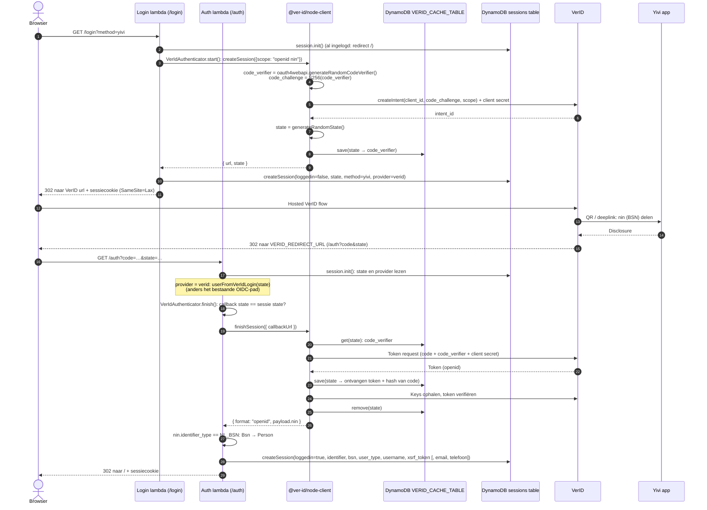

# Inloggen met Yivi via VerID

Als `USE_YIVI_VERID=true` en de VeridAuthenticationClient inclusief configuratie correct is, loopt de Yivi-login via VerID in plaats van Signicat. Dit is een OAuth authorization code flow met PKCE (S256). De library `@ver-id/node-client` genereert zelf de `state` en de `code_verifier` en bewaart de verifier in de VERID_CACHE_TABLE, zodat de login- en auth-lambda hem allebei kunnen gebruiken.

Cold start login/auth lambda: verIdAuthenticatorFromEnv() bouwt de client (issuer, clientId, secret uit Secrets Manager, redirectUri, DynamoDBCacheManager TTL 600s).Mislukt dit, dan valt Yivi terug op Signicat (of wordt verborgen).

## Waar de flow kan stoppen

| Stap | Situatie | Resultaat |
|------|----------|-----------|
| Opstart | Flag uit of VerID-client niet op te zetten | Geen authenticator: Yivi via Signicat (of verborgen) |
| /login | `method=yivi` terwijl Yivi uit staat | 302 naar `/login` |
| /login | `createSession` faalt (intent geweigerd, VerID onbereikbaar) | 503-foutpagina, niets gecached |
| /auth | `?error=` in de callback (geannuleerd) | 302 naar `/login` |
| /auth | Geen sessiecookie / sessie niet gevonden | 302 naar `/login` |
| /auth | Callback state ≠ sessie state | 302 naar `/login` |
| /auth | Geen verifier voor de state (na 10 min verlopen of al gebruikt) | 302 naar `/login` |
| /auth | Token niet in openid-formaat of nin is geen `NL_BSN` | 302 naar `/login` |
| /auth | Opslaan van de ingelogde sessie faalt | 500 |

## Code

- `src/shared/VerIdFromEnv.ts`: bouwt de client uit de environment, met de DynamoDB-cache voor de verifier
- `src/shared/VerIdAuthenticator.ts`: `start()` en `finish()`, state-check en BSN uit het token
- `src/app/login/loginRequestHandler.ts`: `setupVerIdRedirect()`
- `src/app/auth/authRequestHandler.ts`: keuze op `provider` en `userFromVerIdLogin()`
- `@ver-id/core`: `openSession()` / `finishWithCode()`; de verifier komt uit `oauth4webapi`
